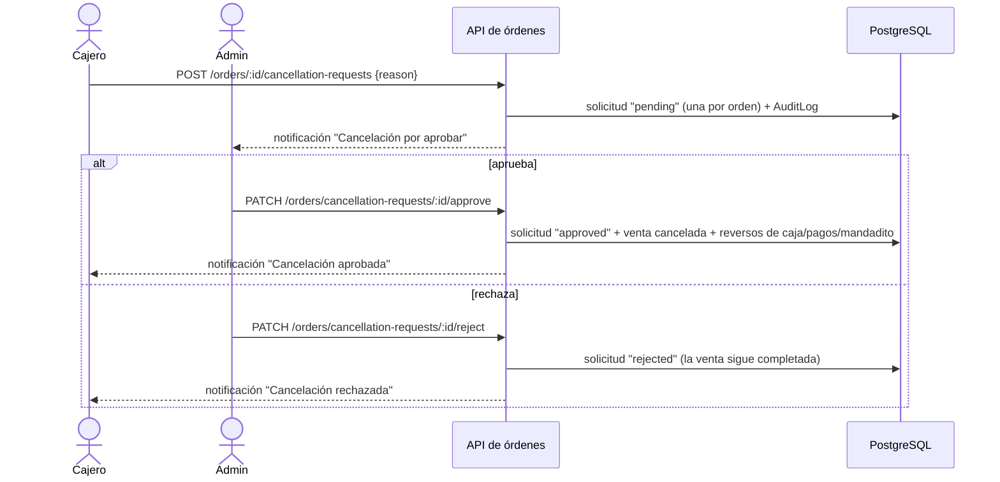

# Auditoría del flujo de ventas — hallazgos y cambios (20/10/2026)

Auditoría funcional y técnica del flujo de ventas del POS: desde que el cajero arma el carrito hasta que la venta se registra y se refleja en caja, inventario, gastos y reportes. Este documento resume lo que se encontró, lo que se decidió con el negocio y lo que se cambió, para que cualquier desarrollador entienda por qué el código quedó como está.

- **Estado:** implementado y probado; **sin commits** al cierre de este documento.
- **Pendiente:** C-10 (fuente del costo de venta), pruebas E2E y aplicar la migración en las bases de desarrollo y producción (ver [Pendientes](#9-pendientes-y-pasos-operativos)).

---

## 1. Resumen

| Fase | Cambios | Qué resuelve |
| ---- | ------- | ------------ |
| 1 — Dinero seguro | C-01, C-02, C-03 | Ventas duplicadas al reintentar, devolución omitida al cancelar, cancelación con un clic |
| 2 — Precio único | C-04, C-05 | El total que veía el cajero no era el cobrado; el mandadito en efectivo no estaba en el cobro |
| 3 — Reglas de negocio | C-06, C-07, C-08, C-09 | 2x1 entre líneas, vender sin stock, cancelar ventas completadas con aprobación, extras en el POS |
| 4 — Carrito y cobros | C-11, C-12 | Controles del carrito, carrito que sobrevive a recargar, cambio al liquidar pendientes |
| 5 — Limpieza | C-13, C-14, C-15, C-16 | Tablero eficiente, una sola API de órdenes, logs y notificaciones, validaciones menores |

Además se encontró y corrigió un bug que no estaba en la matriz: **los productos con temperatura "Ambas" (`BOTH`) no se podían vender** (ver [§4](#4-bug-adicional-productos-ambas)).

---

## 2. Método

1. Lectura del flujo real en el código: `DashboardPage` → `POST /api/orders` → `OrderService.create` → repositorios → Prisma, y de los módulos que toca una venta (caja, inventario, gastos, estado de resultados, notificaciones).
2. Comparación con el comportamiento esperado de un POS y clasificación de hallazgos por categoría y prioridad (P0–P3).
3. Plan por fases pequeñas; cada fase se implementó, se probó (unitarias + integración contra PostgreSQL en Docker) y se validó antes de continuar.
4. Las reglas de negocio dudosas se resolvieron con el responsable del negocio antes de implementarlas ([§3](#3-decisiones-de-negocio-20102026)).

Convención de los hallazgos: **[C]** confirmado en el código · **[R]** riesgo que el código permite · **[H]** hipótesis que depende de datos o de una decisión.

---

## 3. Decisiones de negocio (20/10/2026)

| Tema | Decisión |
| ---- | -------- |
| Promociones por cantidad (2x1, "n por $X") | Juntan todas las unidades que cubren, aunque estén en líneas distintas (caliente y frío, con o sin nota). La nota solo describe propiedades del producto. |
| Vender sin stock | Se permite. El cálculo de insumos por receta queda **fuera del MVP**: la venta ya no toca el inventario. |
| Cancelar una venta ya completada | Solo con aprobación del administrador: el cajero lo solicita con un motivo y el admin aprueba o rechaza. |
| Extras | Se venden desde el POS, con administración completa (catálogo, vínculo con productos, selector en el POS). |

Decisión técnica tomada durante la implementación: **el extra se cobra por unidad** del producto (2 lattes con "1 shot" llevan 2 shots). Antes de este cambio el POS no enviaba extras, así que no hay ventas históricas afectadas.

---

## 4. Bug adicional: productos "Ambas"

La validación de temperatura de una venta rechazaba cualquier temperatura para un producto `BOTH`:

- sin temperatura → "Selecciona caliente o frío";
- con temperatura → "La temperatura seleccionada no está disponible".

Es decir, esos productos no se podían vender. Se corrigió en `backend/src/services/sale-pricing.service.ts` (un producto `BOTH` acepta caliente o frío; los demás solo la suya) y quedó cubierto por `backend/test/sale-pricing.test.ts`.

---

## 5. Matriz de hallazgos y estado

| ID | Prio | Categoría | Problema | Estado |
| -- | ---- | --------- | -------- | ------ |
| H-01 [C] | P1 | Integridad | La clave de idempotencia se generaba en cada llamada HTTP: reintentar tras perder la respuesta creaba otra venta | ✅ C-01 |
| H-02 [C] | P1 | Regla de negocio | El total del POS (precio del menú × cantidad) no era el que cobraba el servidor (2x1, multibuy); el cambio se calculaba sobre ese total | ✅ C-04 |
| H-03 [C] | P1 | Integridad | Cancelar un pedido pendiente liquidado en efectivo en otra sesión de caja no registraba la devolución | ✅ C-02 |
| H-04 [C] | P1 | UX (riesgo financiero) | Cancelar desde el tablero era un clic, sin confirmación ni motivo | ✅ C-03 |
| H-05 [C] | P2 | Regla de negocio | El mandadito cobrado en efectivo no estaba en el "total a cobrar" ni en la validación del monto recibido | ✅ C-05 |
| H-06 [C] | P2 | Regla de negocio | Las promociones se calculaban por línea: una nota o una temperatura distinta rompía el 2x1 | ✅ C-06 |
| H-07 [C] | P2 | Bug | Poner nota a un combo podía sumar la unidad a otro combo | ✅ C-06 (la nota ya no separa líneas) |
| H-08 [C] | P2 | Funcionalidad | El backend soportaba extras pero el POS no permitía venderlos | ✅ C-09 |
| H-09 [C] | P2 | UX / regla | "Stock insuficiente" bloqueaba la venta sin decir qué insumo faltaba | ✅ C-07 (la venta ya no toca inventario) |
| H-10 [C] | P2 | UX | Los errores al cambiar de estado se mostraban genéricos | ✅ C-03 |
| H-11 [H] | P2 | Regla de negocio | Una venta completada no se podía cancelar ni devolver | ✅ C-08 (con aprobación) |
| H-12 [C] | P2 | Rendimiento | El tablero pedía 100 órdenes de cualquier fecha cada 15 s y cada lectura activaba pedidos programados (escritura) | ✅ C-13 |
| H-13 [R] | P2 | Bug / arquitectura | El POS deducía la temperatura por nombre sin categoría; el servidor con categoría (rechazos y líneas duplicadas) | ✅ C-11 (la resuelve el menú) |
| H-14 [H] | P3 | Integridad | El costo de venta usa `Product.cost` (manual) y no receta × costo promedio | ⏳ C-10, requiere decisión |
| H-15 [C] | P3 | UX | Liquidar un pendiente en efectivo no registraba recibido ni cambio | ✅ C-12 |
| H-16 [C] | P3 | UX | El carrito se perdía al recargar | ✅ C-11 |
| H-17 [C] | P3 | UX | El método de pago se reiniciaba en cada venta; mensajes engañosos | ✅ C-11 |
| H-18 [C] | P3 | UX | La "X" solo restaba una unidad; el panel desaparecía mientras se procesaba | ✅ C-11 |
| H-19 [C] | P3 | Redundancia | Helper de errores duplicado que mostraba JSON de Zod al usuario | ✅ C-11 / C-14 |
| H-20 [C] | P3 | Arquitectura | Tres clientes y tipos de órdenes en el frontend, con tipos desactualizados | ✅ C-14 |
| H-21 [C] | P3 | Redundancia | Alerta local de pedidos programados con `localStorage` directo, duplicando el recordatorio del servidor | ✅ C-14 (eliminada) |
| H-22 [C] | P3 | UX | Cada venta notificaba también a quien la creó | ✅ C-15 |
| H-23 [C] | P3 | Observabilidad | Logs de auditoría dentro de la transacción (aparecían en reintentos que no se confirmaron) | ✅ C-15 (parcial, ver nota) |
| H-24 [R] | P3 | Arquitectura | Los reversos de caja de la cancelación dependían de `inventoryProcessed` | ✅ C-07 |
| H-25 [C] | P3 | Seguridad (menor) | Esquema de cambio de estado no estricto; se podían editar ventas canceladas | ✅ C-16 |
| H-26 [C] | P3 | Integridad (menor) | En combos, `unitPrice × cantidad` puede diferir un centavo de `subtotal` | ✅ C-16 (documentado: `subtotal` manda) |
| H-27 [C] | P2 | Pruebas | Faltaban pruebas de mandadito, liquidar-y-cancelar, promociones entre líneas, programados | ✅ pruebas nuevas ([§8](#8-pruebas)) |
| H-28 [C] | P3 | Bug (adyacente) | Una falla al notificar apertura/cierre de caja devolvía 500 aunque la operación ya estaba guardada | ✅ C-15 |

**Nota H-23:** los logs ahora se emiten después del commit. La activación automática de pedidos programados **no** se guarda en `audit_logs` porque la tabla exige un usuario y la activación la hace el sistema (cron); sigue registrada en el log estructurado (Pino).

---

## 6. Cambios por fase

### Fase 1 — Dinero seguro

**C-01 · Idempotencia por intento de venta.** La clave `X-Idempotency-Key` identifica el intento de venta, no la petición: se conserva mientras el carrito, el pago, el mandadito y la programación no cambien (el monto recibido no cuenta), y se renueva tras una venta exitosa. Desde C-11 también se guarda en `sessionStorage`, así que recargar la pestaña tras perder la respuesta no cobra dos veces.
- `frontend/src/features/dashboard/pages/DashboardPage.tsx` (`useSaleAttemptKey`), `frontend/src/features/orders/services/order.service.ts` (`createOrder`).

**C-02 · Devolución al cancelar pedidos liquidados en otra caja.** La búsqueda del cobro a devolver ya no filtra por la caja donde se creó la orden; `resolveReversalSessionId` decide si el reverso va a la caja original (abierta) o a la abierta actual.
- `backend/src/services/order.service.ts` (`reverseSaleForCancellation`).

**C-03 · Confirmación y motivo al cancelar.** El tablero y "Órdenes del día" usan el mismo diálogo (`CancelOrderDialog`) con motivo, que queda en `AuditLog.metadata.reason`. Los errores muestran el mensaje del servidor.
- `frontend/src/features/orders/components/CancelOrderDialog.tsx`, `frontend/src/shared/components/ConfirmDialog.tsx` (acepta contenido extra y `confirmDisabled`).

### Fase 2 — Precio único

**C-04 · Cotización del servidor.** Todo el cálculo de precios vive en una función pura, `priceSale`, usada por la venta (dentro de su transacción Serializable) y por `POST /api/orders/quote`, que no escribe nada. El POS cotiza el carrito (con 300 ms de espera tras cada cambio), muestra importe por línea, promociones y total del servidor, y no deja cobrar en efectivo mientras el total no esté calculado.
- `backend/src/services/sale-pricing.service.ts`, `backend/src/services/order.service.ts` (`quote`), `frontend/src/features/dashboard/hooks/useOrderQuote.ts`, `OrderDetailsPanel.tsx`, `CashPaymentDialog.tsx`.

**C-05 · Efectivo con mandadito.** Si la venta y el mandadito se pagan en efectivo, el monto recibido debe cubrir ambos y el cambio se calcula sobre los dos. El diálogo muestra el desglose y también se abre cuando solo el mandadito es en efectivo. El mandadito sigue sin ser ingreso.

### Fase 3 — Reglas de negocio

**C-06 · Promociones por carrito.** `calculateCartPromotions` junta las unidades de todas las líneas que cubre cada promoción. En un 2x1 la unidad gratis es la más barata de cada par; en "n por $X" se agrupan primero las unidades más caras y el descuento se reparte entre líneas en centavos exactos. Las promociones no se acumulan: primero se aplica la que más ahorra y toma las líneas que cubre. En el POS, la nota describe la línea completa y ya no la separa.
- `backend/src/services/pricing.service.ts`, `sale-pricing.service.ts`, `DashboardPage.tsx` (`handleUpdateItemNote`).

**C-07 · Vender sin tocar inventario.** La venta ya no descuenta insumos ni crea movimientos de inventario, y nunca falla por stock. La cancelación siempre revierte caja, pagos y mandadito; solo devuelve insumos si la venta es anterior a este cambio y sí los consumió (`inventoryProcessed`). Se eliminaron `OrderRepository.findRecipes` e `InventoryRepository.decrementStockIfAvailable`.

**C-08 · Cancelar ventas completadas con aprobación.**

- Si quien solicita tiene `sales.approve_cancellation` (el admin), la solicitud se aprueba en la misma transacción.
- Un índice único parcial impide dos solicitudes pendientes para la misma orden, y la aprobación es condicional: dos aprobaciones simultáneas solo devuelven el efectivo una vez.
- La cancelación directa y la aprobada comparten `reverseSaleForCancellation` e `invalidateCancelledSaleSnapshots`.
- UI: en el tablero, una orden completada muestra "Solicitar cancelación" (o "Cancelar venta" para el admin) y el estado de su última solicitud; el admin ve "Cancelaciones por aprobar" arriba del tablero. "Órdenes del día" también lo permite.
- `backend/src/services/order.service.ts`, `backend/src/repositories/order.repository.ts`, `frontend/src/features/orders/components/CancellationRequestsPanel.tsx`, `OrderActions.tsx`, `hooks/useCancellationRequests.ts`.

**C-09 · Extras en el POS.**
- Backend: módulo de extras (`extra.routes.ts`, `extra.service.ts`, `extra.repository.ts`, `extra.validator.ts`) con permisos `products.*`; un extra ya vendido no se elimina, se desactiva. `PATCH /api/products/:id/extras` define qué extras ofrece un producto. `GET /api/menu` devuelve los extras activos de cada producto. El precio del extra es por unidad (`OrderItemExtra.quantity` guarda el total de la línea).
- Frontend: pestaña **Inventario → Extras** (`features/extras/`), selector de extras en el formulario de producto, `ExtrasPicker` en el POS (tarjeta de producto y modal de personalización), extras visibles en cada línea del carrito.

### Fase 4 — Carrito y cobros

**C-11 · Carrito robusto.** Botones −, + y "Eliminar" por línea; el pedido sigue visible (bloqueado) mientras se envía; "Efectivo" por defecto; mensajes que dicen qué falta; carrito guardado en `sessionStorage` por usuario (`shared/hooks/useSessionState.ts`); la temperatura la resuelve el servidor en el menú (`menu.service.ts`) y el POS ya no la adivina.

**C-12 · Liquidar pendientes con cambio.** En efectivo se pide el monto recibido, se muestra el cambio y ambos se guardan en el movimiento de caja; recibir menos se rechaza (`settlePaymentSchema.cashReceived`).

**C-11b · Modal de personalización estable.** Al cambiar caliente/frío, el modal volvía al primer sabor de esa temperatura (y perdía los extras elegidos); ahora conserva el mismo producto si admite ambas temperaturas o el mismo sabor en la otra. Si el sabor elegido no tiene Jumbo, se usa Regular en lugar de dejar un Jumbo sin precio, y "Agregar al pedido" se deshabilita mientras no haya un precio válido (antes no hacía nada sin avisar).
- `frontend/src/features/menu/components/MenuSection.tsx` (`ProductFamilyModal`).

### Fase 5 — Limpieza

**C-13 · Tablero eficiente.** `GET /api/orders?board=true` devuelve las órdenes abiertas de cualquier día más las creadas hoy; las terminadas de días anteriores quedan en "Órdenes del día". Las lecturas ya no activan pedidos programados (lo hace `jobs/orderScheduled.job.ts` cada minuto).

**C-14 · Una sola API de órdenes en el frontend.** `createOrder` y `quoteOrder` se movieron a `features/orders/services/order.service.ts`; se eliminaron el servicio duplicado del dashboard, los tipos `Order` obsoletos y la alerta local de pedidos programados.

**C-15 · Logs y notificaciones.** Logs de auditoría después del commit; quien crea la venta no recibe su propia notificación; las notificaciones de caja ya no convierten en 500 una operación ya guardada.

**C-16 · Endurecimientos menores.** `updateOrderStatusSchema` estricto; no se editan ventas canceladas; documentado que en combos `subtotal` es el importe de referencia.

---

## 7. Cambios de API y base de datos

### Endpoints nuevos o modificados

| Método y ruta | Permiso | Cambio |
| ------------- | ------- | ------ |
| `POST /api/orders/quote` | `sales.create` | **Nuevo.** Precio del carrito sin crear nada: `{ items[] }` → `{ items[{gross, discount, net}], subtotal, discount, total }` |
| `POST /api/orders` | `sales.create` | Usa `priceSale`; valida efectivo de venta + mandadito; ya no toca inventario; extras por unidad |
| `GET /api/orders` | (en el servicio) | Nuevo parámetro `board=true`; incluye la última solicitud de cancelación |
| `PATCH /api/orders/:id/status` | (en el servicio) | Body estricto `{ status, reason? }`; una venta `completed` ya no se cancela por aquí |
| `PATCH /api/orders/:id` | `sales.update` | Rechaza editar ventas canceladas |
| `PATCH /api/orders/payments/:paymentId/settle` | `sales.create` | Nuevo campo opcional `cashReceived` (solo efectivo) |
| `POST /api/orders/:id/cancellation-requests` | `sales.create` | **Nuevo.** `{ reason }` |
| `GET /api/orders/cancellation-requests` | `sales.approve_cancellation` | **Nuevo.** Solicitudes pendientes |
| `PATCH /api/orders/cancellation-requests/:requestId/approve` · `/reject` | `sales.approve_cancellation` | **Nuevo.** `{ comment? }` |
| `GET/POST /api/extras`, `PATCH /api/extras/:id`, `PATCH /api/extras/:id/active`, `DELETE /api/extras/:id` | `products.read/create/update/delete` | **Nuevo** módulo de extras |
| `PATCH /api/products/:id/extras` | `products.update` | **Nuevo.** `{ extraIds[] }` |
| `GET /api/menu` | público | Cada producto trae `extras[]` y la temperatura ya resuelta |

### Migración `20261020120000_add_order_cancellation_requests`

Solo agrega (no modifica tablas ni columnas existentes):

- tipo `CancellationRequestStatus` (`pending`, `approved`, `rejected`) y tabla `order_cancellation_requests`;
- índice único parcial `orderCancellationRequests_one_pending` (una solicitud pendiente por orden), declarado en SQL porque Prisma no admite `WHERE`;
- permiso `sales.approve_cancellation`, otorgado al rol `ADMIN` (también en `prisma/seed.ts`).

Se ensayó en la base de pruebas de Docker (`prisma migrate diff` contra el esquema: sin diferencias). **No se ha aplicado en desarrollo ni en producción.**

---

## 8. Pruebas

Al cierre: **97/97 unitarias** y **86/86 de integración** (PostgreSQL en Docker), lint, verificación de tipos y build del frontend. Las E2E no se ejecutaron porque los puertos 4000 y 5173 estaban ocupados por los servidores de desarrollo.

| Archivo | Cubre |
| ------- | ----- |
| `backend/test/sale-pricing.test.ts` (nuevo) | Promoción en línea y total, extras por unidad, combos, Jumbo, productos "Ambas", validación de catálogo |
| `backend/test/pricing.service.test.ts` | 2x1 entre líneas, tamaños mezclados, "2 por $99" con productos distintos, promociones que no se acumulan |
| `backend/test/integration/promotions.integration.test.ts` (nuevo) | Promociones reales del seed en su día y fuera de él (lunes 2x1, miércoles bagels, viernes 2 por $99) |
| `backend/test/integration/cancellation-requests.integration.test.ts` (nuevo) | Solicitud, conflicto, permisos, notificaciones, aprobación con reversos, rechazo, autoaprobación, aprobaciones simultáneas |
| `backend/test/integration/extras.integration.test.ts` (nuevo) | Catálogo de extras, vínculo con productos, menú, venta por unidad, desactivar/eliminar |
| `backend/test/integration/orders-board.integration.test.ts` (nuevo) | Filtro del tablero (`board=true`) |
| `backend/test/integration/financial-regressions.integration.test.ts` | H-03b (liquidado en otra caja), C-07 (venta antigua con insumos), C-12 (cambio al liquidar) |
| `backend/test/integration/pricing-regressions.integration.test.ts` | C-04 (cotización = cobro), C-05 (efectivo + mandadito) |
| `backend/test/integration/order-creation.integration.test.ts` | La venta no toca inventario y no se bloquea por stock |

---

## 9. Pendientes y pasos operativos

1. **Aplicar la migración** antes de usar el backend nuevo: `npm run prisma:migrate:deploy` en `backend/` (desarrollo) y, en producción, desplegar código y migración juntos, solo después de listar las migraciones pendientes y aprobarlas (procedimiento en la sección *Deployment* de `CLAUDE.md`). Sin ella, el tablero de Órdenes falla porque consulta `order_cancellation_requests`.
2. **C-10 — fuente del costo de venta:** decidir si `costSnapshot` debe calcularse con receta × costo promedio en lugar de `Product.cost`. Hoy, con el inventario fuera del MVP, el costo manual es el único disponible.
3. **Pruebas E2E** (`npm run test:e2e`) con los servidores de desarrollo apagados.
4. **Prueba manual en tema claro y oscuro:** 2x1 en lunes con lattes caliente y frío; venta con extras; efectivo + mandadito; recargar a mitad de una venta; cancelación con aprobación (cajero → admin); liquidar un pendiente con cambio.
5. **`backend/test/db/prepare.ts`** termina **todos** los procesos `node.exe` en Windows (también los servidores de desarrollo). Para preparar la base de pruebas sin cerrarlos, exportar las variables de prueba (`DATABASE_URL`/`DIRECT_URL` a `localhost:55432`, `NODE_ENV=test`), comprobar con `npx prisma migrate status` que apunta a Docker y ejecutar `npx prisma migrate deploy` y `npx tsx prisma/seed.ts`. Conviene corregir el script.
