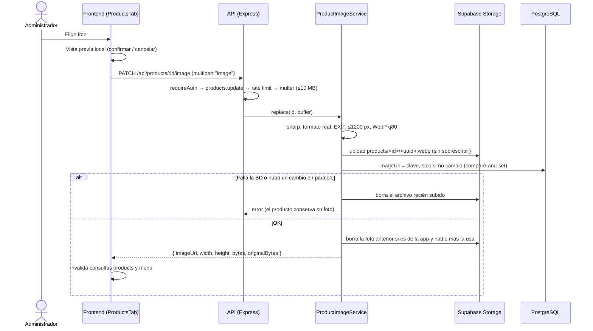

# Imágenes de productos — auditoría y nuevo flujo (20/10/2026)

Cambio del manejo de las fotos del catálogo: carga desde la interfaz, conversión a WebP en el servidor, almacenamiento en Supabase Storage, eliminación segura y migración de las fotos existentes. Este documento explica qué estaba mal, qué se cambió y qué falta aplicar en los entornos reales.

- **Estado:** implementado y probado en local (unitarias + integración contra PostgreSQL en Docker). Sin cambios de esquema de Prisma.
- **Pendiente:** configurar las variables de Storage y ejecutar la migración de fotos en desarrollo y producción ([§8](#8-despliegue)). La red desde la que se hizo el trabajo bloquea Supabase, así que no se aplicó nada en esos entornos.

---

## 1. Diagnóstico

| # | Problema | Causa | Archivos |
| - | -------- | ----- | -------- |
| 1 | El menú de ventas tardaba en cargar las fotos | 14 de 30 fotos medían 3105×3105 px y pesaban entre 2.5 y 8.5 MB (88 MB en total) para tarjetas de unos 150 px. El origen (bucket o build) no era la causa | Fotos del menú |
| 2 | No se podía cambiar la foto sin desplegar | Tras quitar el bucket, el formulario solo elegía fotos incluidas en el frontend | `ProductsTab.tsx` |
| 3 | Un reemplazo o un borrado podía romper otro producto | El archivo anterior se borraba sin revisar si otro producto o combo lo usaba (el Viajero lo comparten un producto y un combo) | antiguo `upload.service.ts`, `product.service.ts` |
| 4 | Imágenes rotas o lentas en la UI | Sin `loading="lazy"`, sin respaldo si falla la descarga; el panel de la orden usaba la foto completa como miniatura de 48 px | `MenuSection.tsx`, `OrderDetailsPanel.tsx` |
| 5 | Almacenamiento no persistente | Render ejecuta un contenedor sin disco persistente: guardar archivos en el backend se pierde en cada despliegue | — |
| 6 | URLs arbitrarias | `POST`/`PATCH /products` aceptaban cualquier URL externa en `imageUrl` | `product.validator.ts` |
| 7 | Asignaciones dispersas | El seed tenía rutas sueltas por producto, algunas con nombres distintos al archivo real (`CoffeeCream` y `CoffeCream`, `Hash` y `Hashbrown`) | `prisma/seed.ts` |

---

## 2. Decisiones

- **Almacenamiento:** Supabase Storage (bucket público `Img`). Ya existía en el proyecto, es persistente y sirve los archivos con caché. La lentitud se resolvió optimizando las fotos, no cambiando de proveedor.
- **Fotos existentes:** se migran al bucket como WebP y se quitan del frontend, para que todas las imágenes se administren igual desde la UI.
- **Sin migración de Prisma:** `imageUrl` sigue siendo `String?`; ahora guarda la **clave dentro del bucket** y la API la convierte en URL pública.

---

## 3. Flujo de carga

**Validación y procesamiento** ([image-processing.service.ts](../../../backend/src/services/image-processing.service.ts)):

- El formato se detecta por el contenido con `sharp`: JPEG, PNG, WebP o AVIF. El `Content-Type` y la extensión del cliente no se usan para decidir.
- Se rechazan archivos dañados o truncados, GIF/SVG, imágenes de menos de 100 px y de más de 50 MP (protección contra bombas de descompresión).
- Se corrige la orientación EXIF, se reduce el lado mayor a 1200 px sin agrandar, se eliminan los metadatos y se codifica como WebP con calidad 80.

**Límites** (configurables en `backend/.env.*`):

| Variable | Por defecto | Uso |
| -------- | ----------- | --- |
| `PRODUCT_IMAGE_MAX_UPLOAD_MB` | 10 | Tamaño máximo del archivo (413 si se excede) |
| `PRODUCT_IMAGE_MAX_DIMENSION` | 1200 | Lado mayor de la imagen guardada |
| `PRODUCT_IMAGE_WEBP_QUALITY` | 80 | Calidad WebP |
| `PRODUCT_IMAGE_BUCKET` | `Img` | Bucket de Supabase |

También hay un límite de 30 subidas por usuario cada 15 minutos, porque el procesamiento usa CPU.

---

## 4. Eliminación segura

`DELETE /api/products/:id/image` quita la referencia del producto. El archivo se libera con `ProductImageService.release`, que también se usa al reemplazar la foto y al eliminar el producto:

| Referencia anterior | ¿Se borra el archivo? |
| ------------------- | --------------------- |
| `products/…` o el antiguo `public/…` (subida por la app), sin otras referencias | Sí |
| Igual, pero usada por otro producto, combo o categoría | No (compartida) |
| `catalog/…` o `Menu/…` (fotos del menú) | Nunca |
| URL externa | Nunca |

- Primero se actualiza la base de datos y después se borra el archivo. Si el borrado falla, la base de datos ya quedó correcta: el archivo queda huérfano y se registra en el log, sin referencias rotas.
- La operación se hace sobre el producto, con el permiso `products.update`. No existe un endpoint que borre archivos por URL o por nombre, así que no se puede borrar un archivo manipulando un identificador.

---

## 5. Visualización

- La API devuelve `imageUrl` como URL pública (`resolveImageUrl`) en `/api/menu`, `/api/products` y `/api/products/:id`. El menú de ventas y el catálogo usan la misma referencia persistida.
- [ProductImage.tsx](../../../frontend/src/shared/components/ProductImage.tsx) se usa en las tarjetas del menú, el diálogo de variantes, el panel de la orden, la tabla del catálogo y el formulario:
  - `loading="lazy"`, `decoding="async"`, `object-cover` dentro de una caja de tamaño fijo, sin saltos de diseño.
  - Logo de Andy's como respaldo si no hay imagen o si la descarga falla.
- [ProductImageField.tsx](../../../frontend/src/features/products/components/ProductImageField.tsx) permite elegir, previsualizar, confirmar o cancelar, reemplazar y quitar (con confirmación).
  - En un producto nuevo, la foto se sube justo después de crearlo.
  - Si una subida falla, se muestra el error y se conserva la foto anterior.
- Después de cada operación se invalidan las consultas `products` y `menu` de TanStack Query, sin recargar la página.

---

## 6. Migración de las fotos existentes

- **Originales:** `backend/assets/menu-images-originals/` (PNG, ignorados por git).
- **Versión optimizada:** `backend/assets/menu-images/` (WebP, versionados). 87 MB → 1.5 MB.
- **Asignaciones:** [prisma/menu-images.ts](../../../backend/prisma/menu-images.ts) define qué foto lleva cada SKU o combo. La usan el seed y el script de migración.

`npm run images:migrate` ([migrate-menu-images.ts](../../../backend/scripts/migrate-menu-images.ts)) aplica estas reglas:

1. Una referencia existente (`Menu/Andys.png` o su URL completa) pasa a la foto del catálogo del **mismo archivo**, por nombre o por un alias documentado. **Se conserva la asignación actual** aunque el mapa sugiera otra.
2. Las asignaciones del mapa solo se aplican a productos sin imagen o con el logo por defecto antiguo (`Menu/LogoAndysVector.svg`).
3. Las fotos subidas desde la app y las que ya están en `catalog/` no se tocan.
4. Lo que no tiene equivalente se reporta y no se modifica.

Por defecto solo simula. Con `--apply` guarda un respaldo en `prisma/backups/menu-images-<fecha>.json`, sube las fotos sin sobrescribir y actualiza las filas con compare-and-set. `--restore <respaldo>` revierte. No borra nada del bucket.

**Simulación contra la base de pruebas** (con los valores del seed anterior): 35 cambios, 0 referencias sin correspondencia.

| Resultado | Detalle |
| --------- | ------- |
| Migradas (misma foto) | 20: Espresso, Latte regular, Caramel Macciato, Biscoff, Latte Andy's, Coffee Cream, Limonada, Bloom, Taro, bagels campirano/pollo/carnívoro, Canadiense, Viajero, Dúo continental, Mini Phila, Hashbrown y los 3 combos |
| Asignadas (sin foto o logo por defecto) | 15: Latte Vainilla, Latte Moka, Americano, Pan de muerto, Bagel americano, 8 chilaquiles, Croissant y Croissant salado |
| Siguen sin foto | Chai vainilla, Chai Guayaba, Latte Jumbo |
| Fotos sin producto | LatteLt, Matcha, Pumpkin, Regular |

> **Latte regular** conserva `Andys` porque es su asignación actual, aunque existe `Regular.webp`. Si se prefiere la nueva, se cambia desde el formulario.

---

## 7. Archivos

**Backend**

| Archivo | Cambio |
| ------- | ------ |
| `src/config/productImages.ts` | Nuevo: configuración y límites validados con Zod |
| `src/utils/imageKeys.ts` | Nuevo: clave ↔ URL pública, claves administradas, nombres únicos, protección contra traversal |
| `src/services/image-processing.service.ts` | Nuevo: validación y conversión a WebP con sharp |
| `src/services/product-image.service.ts` | Nuevo: reemplazar, quitar y liberar archivos con compensación |
| `src/repositories/image-storage.repository.ts` | Nuevo: Supabase Storage (sustituible en pruebas) |
| `src/repositories/image-reference.repository.ts` | Nuevo: cuenta referencias en productos, combos y categorías |
| `src/middleware/image-upload.middleware.ts` | Nuevo: multer con límites y rate limit |
| `src/repositories/product.repository.ts` | `replaceImageIfUnchanged` (compare-and-set) |
| `src/services/product.service.ts`, `menu.service.ts` | Devuelven la URL pública; al borrar un producto se libera su foto |
| `src/routes/product.routes.ts`, `controllers/product.controller.ts` | `PATCH` y `DELETE /products/:id/image` |
| `src/validators/product.validator.ts` | Ya no acepta `imageUrl` |
| `src/middleware/errorHandler.ts`, `utils/errors.ts` | 413 (tamaño), 503 (Storage sin configurar), 502 (error de Storage) |
| `prisma/menu-images.ts`, `prisma/seed.ts` | Mapa de fotos y reglas de migración; el seed usa claves `catalog/…` |
| `scripts/build-menu-images.ts`, `scripts/migrate-menu-images.ts` | Conversión de originales y migración |
| `assets/menu-images/` | 30 fotos WebP |

**Frontend**

| Archivo | Cambio |
| ------- | ------ |
| `shared/components/ProductImage.tsx` | Nuevo: imagen con carga diferida y respaldo |
| `features/products/components/ProductImageField.tsx` | Nuevo: campo de imagen del formulario |
| `features/products/hooks/useImageDraft.ts` | Nuevo: vista previa local y validación previa |
| `features/products/hooks/useProducts.ts`, `api/product.api.ts` | `useProductImage`, `uploadImage`, `removeImage` |
| `features/inventory/components/tabs/ProductsTab.tsx` | Gestión de imagen y miniatura en la tabla |
| `MenuSection.tsx`, `OrderDetailsPanel.tsx`, `DashboardPage.tsx` | Usan `ProductImage` y la URL de la API |
| `shared/images/`, `shared/utils/menuImages.ts` | Eliminados (las fotos ya no van en el build) |

---

## 8. Despliegue

Desde una red que llegue a Supabase y en este orden:

1. Definir `SUPABASE_URL` y `SUPABASE_SERVICE_ROLE_KEY` en `backend/.env.development` y `backend/.env.production`. La service role key es solo para el backend, nunca para el frontend.
2. Ejecutar `cd backend && npm run images:migrate`, revisar la simulación y después `npm run images:migrate -- --apply`.
3. Repetir con `npm run images:migrate:prod` y luego `npm run images:migrate:prod -- --apply`.
4. Agregar las mismas dos variables en Render y desplegar backend y frontend.
5. Probar en el navegador, en temas claro y oscuro: subir, reemplazar y quitar una foto, y verla en el menú de ventas.

Si el código se despliega antes de migrar, nada se rompe: los valores `Menu/...` se siguen resolviendo contra el bucket mientras esos archivos existan.

---

## 9. Pruebas

| Suite | Resultado | Cubre |
| ----- | --------- | ----- |
| Unitarias (`npm run test:unit`) | 133/133 | Conversión real a WebP y reducción de peso, EXIF, metadatos, archivos dañados o no admitidos, límites, compensación ante fallos de Storage y BD, conflicto en paralelo, archivos compartidos, permisos, reglas de migración |
| Integración (`npm run test:integration`) | 93/93 | Subida multipart, 401/403/413, reflejo en catálogo y `/api/menu`, conservación de la foto ante un reemplazo fallido, archivo compartido, eliminación, `imageUrl` arbitraria ignorada |

**No ejecutadas:** E2E (Playwright) y la prueba manual en el navegador, porque desde esta red no se alcanza la base de Supabase.

---

## 10. Riesgos pendientes

- Las fotos subidas antes desde la app (`public/…`) se conservan, pero no se optimizan.
- Las imágenes de los combos solo se asignan por seed o migración; no hay pantalla de combos.
- `imageUrl` de las categorías todavía acepta una URL libre. Hoy no se muestra en ningún lado.
- Un borrado fallido en Storage deja un archivo huérfano registrado en el log; no hay limpieza automática.
- Las fotos viejas `Menu/…` siguen en el bucket. Se pueden borrar a mano cuando la migración esté verificada en producción.
