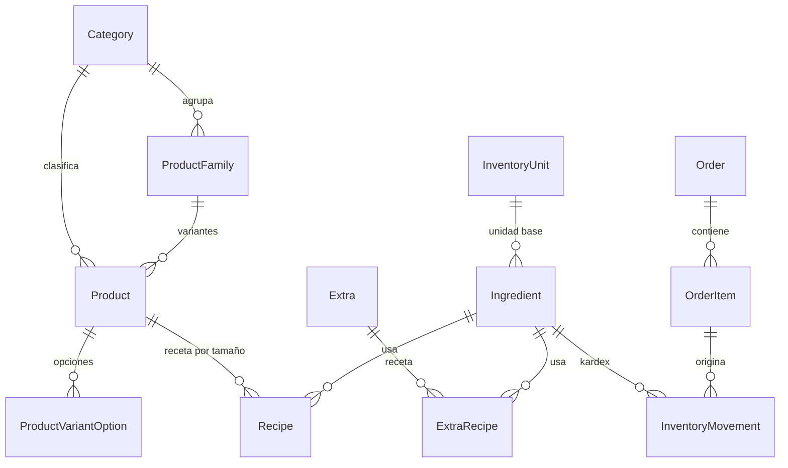
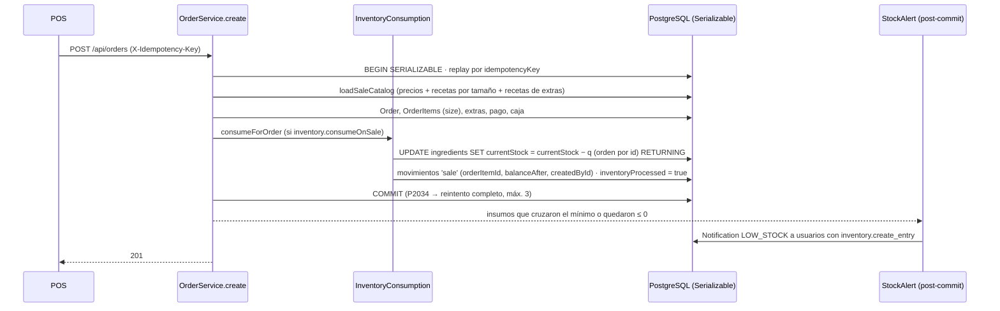

# Plan técnico — Control de inventario en tiempo real y normalización del catálogo (Andy's Coffee)

> Estado: **aprobado el 11-nov-2026**; implementación pendiente de autorización por fase.

## Contexto

El inventario de Andy's Coffee ya existe en buena parte (insumos, compras con costo promedio, salidas manuales, conteos físicos, historial, panel de stock bajo). Lo que **no** existe es el vínculo venta → insumos: el 20-oct-2026 (decisión **C-07**, `docs/Project/FIXED/[FIXED] auditoria-flujo-ventas 20-10-26.md`) se quitó el consumo por receta para que una venta nunca fallara por falta de stock (`backend/src/services/order.service.ts:562-564`). Además, el modal de productos no permite capturar ingredientes, y el catálogo guarda atributos (familia, sabor, salsa, proteína, tamaño) dentro del **nombre** del producto.

Este plan: (1) normaliza el catálogo y las unidades, (2) hace que el modal de producto capture la receta al crear/editar, (3) reactiva el consumo por receta **sin volver a bloquear ventas**, y (4) añade alertas y sugerencias de compra.

### Decisiones tomadas con el usuario (11-nov-2026)

| # | Decisión | Consecuencia |
|---|----------|--------------|
| D-1 | Si un insumo no alcanza, **la venta se registra y el stock queda negativo** | Se mantiene C-07. Se elimina sólo `currentStock >= 0` del CHECK; negativo genera alerta y se corrige con conteo |
| D-2 | Se descuenta **al crear el pedido** (misma transacción), también programados y con pago pendiente | Sin descuentos prematuros ni duplicados |
| D-3 | **Receta por tamaño** (REGULAR / JUMBO) | `size` en `Recipe` y `OrderItem` |
| D-4 | Normalización **inventario + atributos**: unidades con conversión, insumos en unidad base, nombre único de producto, familia/variante/temperatura en columnas; el POS deja de leer el nombre, sin rediseñar su modal | Tablas `ProductFamily` y `ProductVariantOption`; script de normalización |
| D-5 | **Receta obligatoria** al crear producto, salvo que se marque "No controla inventario" | `Product.tracksInventory`; producto + receta + extras en una sola petición transaccional |

---

## 1. Diagnóstico del sistema actual

### 1.1 Datos reales en desarrollo (exportados el 11-nov con `npm run catalog:export`, sólo lectura)

| Entidad | Cantidad | Observaciones |
|---------|----------|---------------|
| Unidades | 5 | Gramo/gr, Kilogramo/kg, Litro/lt, Mililitro/ml, Pieza/pz — limpias, sin factor de conversión |
| Categorías | 5 | Bebidas, Bagels, Desayunos, Combos, Otros |
| Productos | 35 | ver hallazgos abajo |
| Insumos | **1** | "vaso" (minúsculas, sin SKU, stock 0) — dato de prueba |
| Recetas / extras / recetas de extras | **0 / 0 / 0** | El catálogo de insumos está por cargar |
| Combos | 3 | "Promo Jueves: 2 Viajeros por $170" es un combo que actúa como promoción |
| Proveedores | 1 | "walmart" |

**Hallazgos de normalización en productos**
1. **"Latte Jumbo" (ESP-01)** es un producto aparte ($98, costo 0) que duplica el tamaño Jumbo (los lattes ya tienen `jumboPrice`). El POS lo oculta por nombre (`MenuSection.tsx:137`).
2. **Atributos en el nombre**: 8 "Chilaquiles {proteína} {salsa}" (2 salsas × 4 proteínas); 7 "Latte {sabor}"; "Bloom"/"Limonada" se agrupan como Refreshers con una lista fija (`MenuSection.tsx:30-56, 75-102`).
3. **Jumbo y bebida por heurística de nombre**: `isJumboLatteProduct` y `getDrinkTemperature` (`backend/src/utils/productTemperature.ts`) dependen de que la categoría se llame "bebidas" y el producto empiece con "latte ". La temperatura ya está guardada en todas las bebidas, pero el código sigue cayendo a la heurística.
4. **SKU con prefijos inconsistentes** (ESP-01/02 frente a BEV-0xx). El SKU es la **clave natural** de `scripts/sync-sales-menu-dev-to-prod.ts` y de `prisma/menu-images.ts` → **no se renombra** (sólo se valida formato en altas nuevas).
5. Costos manuales en 0 (ESP-01, ESP-02); `displayOrder` repetido (Mini bagel y Papa Hashbrown = 5).
6. Producto sin unicidad de nombre (insumos y proveedores sí la tienen, `LOWER(TRIM(name)) WHERE isActive`).

**Riesgo latente**: `backend/scripts/seed-inventory.ts` (115 insumos reales del negocio) busca unidades por nombre `g`, `L`, `pieza`, `bote`, `paquete` que **no coinciden** con las sembradas (`Gramo`, `Litro`, `Pieza`) → crearía unidades duplicadas. Además asigna unidades erróneas (vasos, tapas, servilletas, popotes y sellos en gramos; caramelo y cebolla en kg; leche en L) y usa IDs/SKU `PROD-xxx` para insumos. Se reemplaza en la Fase 2.

### 1.2 Modal de productos (`frontend/src/features/inventory/components/tabs/ProductsTab.tsx`, 851 líneas)

- Campos: nombre, descripción, SKU (obligatorio en UI; el backend genera `SKU-<uuid>` si falta), precio, precio Jumbo, costo manual, categoría, temperatura (obligatoria si la categoría se llama "Bebidas"), orden, extras ofrecidos, imagen.
- Guardado **no atómico**: `createAsync` → `setProductExtras` → subida de imagen (3 peticiones; si falla la 2.ª queda un producto sin extras).
- Sólo muestra "Costo según receta" (`suggestedCost`, R-04) en edición, de lectura.
- No hay forma de capturar ingredientes; tampoco en `ExtrasTab`.

### 1.3 Inventario y ventas — qué existe y se reutiliza

| Área | Implementación actual | Archivos |
|------|----------------------|----------|
| Insumos | `currentStock`, `minimumStock`, `averageCost` Decimal(14,4), soft delete, SKU opcional | `schema.prisma:201-233`, `inventory.service.ts` |
| Recetas | `Recipe`, `ExtraRecipe` — sólo lectura (costo sugerido) | `schema.prisma:235-261`, `product.service.ts:52-57` |
| Compras | Borrador → recibida, costo promedio (ya usa el costo nuevo si stock ≤ 0), idempotencia, Serializable | `purchase.service.ts:124-210` |
| Salidas | Razones `waste, sample, internal_consumption, donation, other` | `inventory.service.ts:143-189` |
| Conteos | draft → completed → applied, `adjustment` | `inventory-count.service.ts` |
| Movimientos | Signo, `referenceType/referenceId`, usuario, idempotencia | `schema.prisma:263-284` |
| Reversa | `reverseSaleForCancellation` si `inventoryProcessed` | `order.service.ts:71-92` |
| Notificaciones | `LOW_STOCK` en enum, nunca emitido; campana con sondeo 30 s | `notification.service.ts`, `NotificationCenter.tsx` |
| Concurrencia | `runInTransaction(work,{serializable})`; `OrderService.create` reintenta P2034 ×3; patrón claim con `updateMany` condicional | `transaction.ts`, `order.service.ts:695-703` |
| Sincronización | dev → prod del menú por SKU | `scripts/sync-sales-menu-dev-to-prod.ts` |
| Permisos | `inventory.view, create_entry, create_exit, adjust, physical_count, create_ingredient, manage_suppliers, delete_ingredient, delete_supplier` (ADMIN todos, CAJERO `view`) | `seed.ts:499-565` |

### 1.4 Defectos que se vuelven críticos al consumir por venta
1. `applyAdjustments` aplica la diferencia calculada al **agregar** el ítem, no `contado − actual`.
2. CHECK `ingredients_stock_nonnegative_check` impide D-1.
3. Filtro `low_stock` aplicado después de paginar; dashboard ignora `deletedAt`.
4. `type` de movimiento sin restricción; tamaño Jumbo no se guarda en `OrderItem`.
5. Frontend sin gating por permiso en pestañas de inventario.

---

## 2. Análisis de brechas

| Requisito | Estado | Acción (fase) |
|-----------|--------|---------------|
| Catálogo normalizado (unidades, atributos, nombres) | ❌ | F1-F2 |
| Receta capturada en el modal de producto/extra | ❌ | F3-F4 |
| Descuento automático por venta, una sola vez | ❌ (C-07) | F5 |
| Concurrencia | ✅ base | Orden determinista + prueba de carrera (F5) |
| Trazabilidad venta/producto/usuario + saldo | Parcial | `orderItemId`, `balanceAfter` (F1, F5) |
| Cancelación | ✅ legado | Regla por estado (F5) |
| Devolución parcial | ❌ | Fuera de alcance (V2) |
| Negativos con política | ❌ | D-1 (F1) |
| Tamaños | ❌ | D-3 |
| Sustitución / opcionales | ❌ | Extras con cantidad negativa |
| Conversiones de unidad | Sólo frontend | `InventoryUnit.factor` + dimensión (F1) |
| Stock máximo, alertas, sugerencias | ❌ | F1, F6, F7 |
| Mermas/dañados | Parcial | Razones `damaged`, `expired` (F2) |
| Historial por producto/periodo | ✅ por insumo | Filtros y columnas (F8) |

---

## 3. Arquitectura propuesta

Se respeta Controller → Service → Repository → Prisma, `requireAuth → checkPermission → validate → controller`, `BusinessRuleError` 409, efectos secundarios después del commit.

### 3.1 Backend — piezas nuevas o modificadas

| Pieza | Tipo | Responsabilidad |
|-------|------|-----------------|
| `services/recipe.service.ts` + `repositories/recipe.repository.ts` + `validators/recipe.validator.ts` | **Nuevo** | Validar y reemplazar recetas (producto por tamaño, extra); conversión de unidad a la base del insumo; auditoría `RECIPE_UPDATED` |
| `product.service.ts` `create/update` | Modificar | Aceptar `recipe`, `extraIds`, `tracksInventory`, `familyId`, `variantLabel`, `options`; todo en **una transacción** (`runInTransaction`) |
| `services/inventory-consumption.service.ts` | **Nuevo** | `computeConsumption` (pura) + `consumeForOrder(tx, …)` + `reverseForOrder(tx, order, mode, …)` |
| `services/stock-alert.service.ts` | **Nuevo** | Detecta cruces de umbral y emite `LOW_STOCK` tras commit |
| `services/replenishment.service.ts` | **Nuevo** | Sugerencias; crea borradores con `PurchaseService.create` |
| `services/product-family.service.ts` (+ repo, controller, rutas) | **Nuevo** | CRUD mínimo de familias |
| `order.service.ts`, `sale-pricing.service.ts`, `order.repository.ts#loadSaleCatalog` | Modificar | Guardar `size`; cargar recetas en la misma consulta; consumir/revertir |
| `menu.service.ts` / `menu.repository.ts` | Modificar | Devolver `family`, `variantLabel`, `options` para que el POS no parsee nombres |
| `utils/productTemperature.ts` | Modificar | Jumbo = `jumboPrice != null && category.isBeverage`; temperatura = columna; heurística sólo como respaldo temporal |
| `inventory-count.service.ts`, `inventory.service.ts`, `inventory.repository.ts`, `dashboard.repository.ts` | Modificar | Defectos de §1.4; `applyStockDeltas` ordenado con `balanceAfter` |
| `scripts/normalize-catalog.ts` | **Nuevo** | Normalización de datos idempotente con `--dry-run` por defecto (§4.3) |
| `scripts/sync-sales-menu-dev-to-prod.ts` | Modificar | Sincronizar también familias, opciones, insumos (por SKU) y recetas |
| `prisma/seed-data/ingredients.ts` | **Nuevo** (reemplaza `scripts/seed-inventory.ts`) | Catálogo de insumos revisado, unidades base, SKU `INS-###` |

**Feature flag**: preferencia `inventory.consumeOnSale` (boolean, default `false`). Activarla exige que todos los productos activos con `tracksInventory` tengan receta REGULAR (y JUMBO si tienen `jumboPrice`); si no, 409 con la lista.

### 3.2 Endpoints

| Método y ruta | Permiso | Descripción |
|---------------|---------|-------------|
| `POST /api/products`, `PATCH /api/products/:id` | `products.create/update` (+ `inventory.manage_recipes` si trae `recipe`) | Body extendido (§3.4) en una transacción |
| `GET /api/products/:id` | `products.read` | Incluye receta por tamaño con costo por línea y total |
| `GET /api/extras/:id`, `POST/PATCH /api/extras` | `products.*` (+ `inventory.manage_recipes`) | Igual para extras (cantidades negativas permitidas) |
| `GET/POST/PATCH /api/product-families` | `products.read/create/update` | Familias |
| `GET /api/inventory/units` | `inventory.view` | Ahora con `dimension` y `factor` |
| `GET /api/inventory/products-without-recipe` | `inventory.view` | Activos con `tracksInventory` sin receta |
| `GET /api/inventory/replenishment?days=14` / `POST /api/inventory/replenishment/purchase` | `inventory.view` / `inventory.create_entry` | Sugerencias / borradores (`X-Idempotency-Key`) |
| `GET /api/inventory/movements` | `inventory.view` | Filtros `type`, `orderId`; `balanceAfter`, pedido, producto, usuario |

Todos pasan `backend/test/route-policy.test.ts`.

### 3.3 Cálculo de consumo (`computeConsumption`)

```
receta = recipes[product][item.size] ?? recipes[product][REGULAR] ?? []
qty_producto[insumo] = receta.qty × item.quantity
qty_extra[insumo]    = extraRecipe.qty × extra.quantity      // extra.quantity ya es por línea
neto[línea, insumo]  = max(Σ qty_producto + Σ qty_extra, 0)
```
- Combos llegan expandidos por producto (`sourceComboId`); 2x1 consume todas las unidades entregadas.
- Sustitución ("leche de almendra" = `+200 ml almendra, −200 ml entera`) y opcionales ("sin azúcar") son extras con cantidades negativas; el neto se acota a 0.
- Productos con `tracksInventory = false` no consumen.
- Merma de preparación: se captura la cantidad bruta (factor de rendimiento = futuro).

### 3.4 Contrato del modal de producto (create/update)

```jsonc
{
  "name": "Latte Vainilla", "sku": "BEV-003", "categoryId": "…", "price": 65, "jumboPrice": 98,
  "cost": 22.88, "temperature": "BOTH", "displayOrder": 3, "description": "…",
  "tracksInventory": true,
  "familyId": "…(Latte)", "variantLabel": "Vainilla",
  "options": [ { "name": "Salsa", "value": "Roja" } ],        // sólo familias con varias dimensiones
  "extraIds": ["…"],
  "recipe": {
    "REGULAR": [ { "ingredientId": "…", "quantity": 18, "unitId": "…gr" } ],
    "JUMBO":   [ { "ingredientId": "…", "quantity": 1, "unitId": "…kg" } ]   // se convierte a la unidad base
  }
}
```
Reglas: `tracksInventory && isActive` ⇒ `recipe.REGULAR` con ≥ 1 línea; `jumboPrice` ⇒ `recipe.JUMBO` obligatoria; insumos activos, sin duplicados por tamaño, cantidad > 0, unidad de la misma dimensión que la del insumo (se convierte con `factor`). En `PATCH`, omitir `recipe` no toca la receta (para no bloquear la edición de los 35 productos actuales). La imagen sigue en su endpoint (`PATCH /products/:id/image`) tras guardar.

---

## 4. Modelo de datos

### 4.1 Migración (escrita a mano, `BEGIN/COMMIT`, ensayada en Docker; producción sólo `prisma:migrate:deploy` con aprobación)

| Cambio | Detalle | Justificación |
|--------|---------|---------------|
| `enum UnitDimension { MASS VOLUME COUNT }` | nuevo | conversiones válidas |
| `InventoryUnit.dimension`, `InventoryUnit.factor Decimal(14,6)` (a la base: gr=1, kg=1000, ml=1, lt=1000, pz=1); UNIQUE `abbreviation`; UNIQUE `LOWER(name)` | backfill por abreviatura de las 5 existentes | una sola fuente de conversión (hoy sólo en `unitConversion.ts`) |
| Regla: `Ingredient.unitId` debe ser unidad base (`factor = 1`) | validado en servicio; el script corrige | stock y recetas siempre en g/ml/pz |
| `Ingredient.sku` → NOT NULL tras backfill `INS-###` | | clave de sincronización dev→prod |
| `Ingredient.maximumStock Decimal(14,4)?` + CHECK `≥ minimumStock` | | sugerencias |
| `enum ProductSize { REGULAR JUMBO }`; `Recipe.size` default REGULAR; único `(productId, size, ingredientId)` | | D-3 |
| `OrderItem.size ProductSize @default(REGULAR)` | | receta correcta y reportes |
| `Product.tracksInventory Boolean @default(true)` | | D-5 |
| `Category.isBeverage Boolean @default(false)` | backfill `true` para "Bebidas" | elimina la detección por nombre |
| `model ProductFamily { id, name, categoryId?, displayOrder, isActive }` + único normalizado de nombre | | familia explícita (Latte, Chilaquiles, Refreshers…) |
| `Product.familyId String?` FK `ON DELETE SET NULL`, `Product.variantLabel String?` | | el POS agrupa por columna |
| `model ProductVariantOption { productId, name, value }` PK `(productId, name)` | | dimensiones múltiples (Salsa, Proteína) sin parsear nombres |
| UNIQUE `products_name_normalized_unique (LOWER(TRIM(name))) WHERE isActive` | se crea tras el script (no hay duplicados hoy) | coherente con insumos/proveedores |
| `InventoryMovement.balanceAfter Decimal(14,4)?`, `orderItemId String?` FK `SET NULL` + índice | | trazabilidad |
| CHECK `type IN ('purchase','exit','adjustment','sale','sale_reversal')` | verificar con `SELECT DISTINCT type` (el seed usa `adjustment` + `referenceType 'initial_balance'`) | sin tipos basura |
| Únicos parciales `(orderItemId, ingredientId) WHERE type='sale'` y `WHERE type='sale_reversal'` | | idempotencia en BD |
| CHECK de stock recreado sin `currentStock >= 0` | | D-1 |
| Seed: permiso `inventory.manage_recipes` (ADMIN); preferencias `inventory.consumeOnSale=false`, `inventory.lowStockNotify=true` | aditivo | |

**No se crean**: tabla de existencias separada, almacenes, tabla de ajustes, stock de producto terminado, grupos de modificadores (fuera de alcance por D-4). Índices parciales/expresión se documentan como comentario en `schema.prisma`.

### 4.2 Diagrama de relaciones (nuevo/modificado)



### 4.3 Normalización de datos (`scripts/normalize-catalog.ts`, idempotente, `--dry-run` por defecto, `--apply` para escribir)

1. Unidades: completa `dimension`/`factor`; si encuentra duplicadas (`g`, `L`, `pieza`…) reasigna insumos a la canónica y borra la duplicada.
2. Insumos: SKU `INS-###` a los que no tienen; convierte insumos en kg/lt a gr/ml (stock, mínimo y costo promedio ÷ factor; recetas × factor) con movimiento `adjustment` de saldo 0 sólo como nota de auditoría; nombres con mayúscula inicial ("vaso" → "Vaso").
3. Categorías: `isBeverage = true` para "Bebidas".
4. Familias: crea Latte, Chilaquiles, Refreshers, etc. a partir de las reglas actuales de `MenuSection.tsx` (`getDrinkFamily`, `REFRESHER_NAMES`, chilaquiles), asigna `familyId` y `variantLabel` (p. ej. "Vainilla"), y para Chilaquiles crea opciones `Salsa` y `Proteína`.
5. "Latte Jumbo" (ESP-01): `isActive = false` (no se borra: `OrderItem` lo referencia con `Restrict` si hubo ventas).
6. Reporte (sin cambios): SKU fuera de patrón, costos en 0, `displayOrder` repetidos, combos que actúan como promoción.
7. Carga del catálogo de insumos revisado (`prisma/seed-data/ingredients.ts`), con la corrección de unidades de `seed-inventory.ts`: vasos, tapas, servilletas, popotes, sellos, bolsas, batidores → **pz**; caramelo, cebolla, jitomate, tomate verde, papas → **gr**; leche, salsas, aceite, masa de waffles → **ml**; "bote"/"paquete" → **pz**. Se agrega "Leche entera" (falta en la lista). **La lista debe revisarla el negocio** antes de `--apply` (duplicados posibles: "Tenedores" vs "Cubiertos (tenedor)", "Bagels" vs "Bagel congelado").

Orden: desarrollo (`--dry-run` → revisión → `--apply`) → sincronizar a producción con el script de sync extendido, con aprobación.

---

## 5. Flujo de operación (venta → insumos)


Cualquier error revierte venta, pago, caja e inventario juntos.

---

## 6. Reglas de negocio (escenarios)

| # | Escenario | Comportamiento | Integridad |
|---|-----------|----------------|-----------|
| 1 | Venta confirmada | Descuento en la misma transacción; `sale` por línea/insumo | Serializable + único parcial |
| 2 | Cancelada antes de confirmarse | No existe: rollback | Atomicidad |
| 3 | Cancelada tras descontar | `pending` → `sale_reversal` total. `preparing/ready/completed` → `sale_reversal` + `exit` razón `waste` (`referenceType 'order_cancellation'`): stock neto igual, reportes separan merma | Claim `inventoryProcessed true→false`; reversa desde los movimientos registrados, no desde la receta actual |
| 4 | Devolución parcial | No soportada (cancelación por pedido) — V2 | — |
| 5 | Devolución completa | = cancelación (completadas con aprobación admin, flujo existente) | `OrderCancellationRequest` |
| 6 | Pago rechazado | Sin pasarela; pago pendiente no liquidado ⇒ cancelar (esc. 3) | — |
| 7 | Ventas simultáneas | UPDATE atómico, orden por `ingredientId`, Serializable + reintento con misma clave | Sin actualizaciones perdidas |
| 8 | Existencias insuficientes | Se vende; stock negativo; alerta | D-1 |
| 9 | Ajuste manual | Sólo por conteo (`inventory.adjust`); no hay PATCH de stock | Movimiento `adjustment` |
| 10 | Conteo con diferencias | Ajuste = `contado − stock actual` releído en la transacción | Corrige §1.4-1 |
| 11 | Agotado | No bloquea; aparece en Agotados y sugerencias | — |
| 12 | Cambio de receta | Sólo ventas futuras; `AuditLog RECIPE_UPDATED` antes/después | Movimientos inmutables |
| 13 | Cambio de ingredientes | Extras/sustituciones; neto ≥ 0 | Cota |
| 14 | Producto/insumo desactivado | Producto: no se vende, receta se conserva. Insumo en receta activa: no se puede desactivar ni borrar (409 con lista) | Bloqueo en servicio |
| 15 | Error en la venta | Rollback total; reintento idempotente | Transacción |
| 16 | Alta de producto sin receta | 400 salvo `tracksInventory = false` | D-5 |
| 17 | Receta con unidad incompatible (pz para un insumo en gr) | 400 | `dimension` |

Movimientos históricos no se editan ni borran; toda corrección es compensatoria. Salidas manuales siguen rechazando `qty > stock`. Alertas sólo al cruzar el umbral.

---

## 7. Diseño de interfaces (frontend)

Componentes compartidos (`Modal`, `Drawer`, `ConfirmDialog`, `StatusBadge`, `TableSkeleton`, `Button`, `Input`, `Select`), variables CSS, `sileo` + `getErrorMessage`, TanStack Query.

| Pantalla | Cambio |
|----------|--------|
| **Modal de producto** (`ProductsTab.tsx`) | Se divide en secciones/pestañas: *General* (actual), *Receta*, *Extras*, *Imagen*. Se extrae el formulario a `ProductFormModal.tsx` (el archivo ya tiene 851 líneas). Nuevos campos: familia (select con "crear"), variante, opciones (sólo si la familia las define), "No controla inventario". Temperatura obligatoria cuando `category.isBeverage` |
| **Sección Receta** (nuevo `RecipeEditor.tsx`, reutilizable en extras) | Pestañas REGULAR / JUMBO (JUMBO visible si hay precio Jumbo; botón "Copiar de Regular ×factor"). Filas: buscador de insumo (`/inventory/search`), cantidad, unidad compatible (de `/inventory/units`), costo de la línea. Pie: costo total de receta, margen vs precio, botón "Usar como costo". Validación cliente = reglas §3.4; mensajes del backend mandan. Gating `inventory.manage_recipes` (sin él la sección es de sólo lectura) |
| Guardado | Una sola mutación (producto + receta + extras); luego la imagen. Se elimina la llamada separada a `useSetProductExtras` desde el modal |
| **Modal de extra** (`ExtrasTab.tsx`) | Misma `RecipeEditor` (sin tamaños; permite cantidades negativas con etiqueta "resta") |
| **POS** (`MenuSection.tsx`) | Mismo diseño; agrupa por `family`/`variantLabel`/`options` de la API en lugar de parsear nombres (heurística sólo si faltan datos, se elimina tras normalizar) |
| Inventario Actual | Estados OK/Bajo/Agotado/**Negativo**; tarjeta "Productos sin receta"; columna máximo |
| Formulario de insumo | `maximumStock`; sólo unidades base |
| Agregar Entrada | Captura en kg/lt convierte a la unidad base con `factor` del backend |
| Reabastecimiento (nueva pestaña) | actual, mín, máx, consumo diario (14 d), cobertura, sugerido, último proveedor/costo → "Crear borrador de compra" |
| Movimientos | Saldo, pedido #, producto, usuario; filtro Venta/Reversa/Merma |
| Salidas | Razones "Dañado", "Caducado" |
| Notificaciones | Ícono `LOW_STOCK` → abre Inventario |
| Permisos UI | Gating por `create_entry/create_exit/physical_count/adjust/manage_recipes` |
| Preferencias | Interruptor "Descontar inventario al vender" (muestra lo que falta si se rechaza) |

---

## 8. Plan de implementación por fases

Complejidad: S (≤ 1 día), M (2-3 días), L (4-5 días).

### Fase 1 — Modelo de datos y permisos · Crítica · L

> **Estado (11-nov-2026): implementada, ensayada en Docker y aplicada en la BD de desarrollo; pendiente en producción.**
> Migración `20261111120000_inventory_realtime_catalog` (paso 1, sólo aditiva). Ajustes respecto al diseño:
> la unicidad de nombre/abreviatura de unidades pasa al paso 2 (después de que `normalize-catalog.ts` fusione duplicados),
> y los CHECK sobre datos existentes (`recipes` cantidad > 0, `extra_recipes` cantidad ≠ 0, tipos de movimiento) se crean
> `NOT VALID` y se validan en el paso 2. El prefijo `inventory.` queda reservado en `PATCH /api/preferences/:key`.
> Pruebas: `test/integration/inventory-schema.integration.test.ts`, `test/preference-reserved.test.ts`.
- **Actividades**: migración §4.1 en dos pasos (columnas/tablas/constraints aditivos; luego NOT NULL de `Ingredient.sku` y único de nombre de producto tras el script); `schema.prisma` + comentarios; `prisma validate/generate`; seed (permiso, preferencias, unidades con factor).
- **Archivos**: `backend/prisma/schema.prisma`, `backend/prisma/migrations/<fecha>_inventory_catalog_normalization/`, `backend/prisma/seed.ts`, `backend/prisma/seed-catalog.ts` + `scripts/export-catalog.ts` (nuevos campos).
- **Aceptación**: aplica limpia en Docker con datos; sin drift salvo índices documentados; `test:critical` verde.
- **Riesgos**: valores `type` inesperados (consulta previa); export/seed desalineados (se actualizan juntos).
- **Pruebas**: inserción de stock negativo; rechazo de `type` inválido y de `maximumStock < minimumStock`; unidad duplicada rechazada.

### Fase 2 — Normalización de datos y correcciones previas · Crítica · M

> **Estado (11-nov-2026): implementada, ensayada en Docker y aplicada en desarrollo** (script `--apply` + migración paso 2). El 12-nov se cargó en desarrollo el catálogo de insumos (`--with-ingredients`, 118 insumos) para las pruebas manuales; en producción sigue pendiente la revisión del negocio.
> - `scripts/normalize-catalog.ts` (simulación por defecto, `--apply`, `--with-ingredients`); ensayado con una copia del catálogo de desarrollo más datos sucios: fusiona unidades, convierte kg/lt a gr/ml con su historial, asigna SKU `INS-###`, crea 7 familias (Latte, Espresso, Americano, Chai, Refreshers, Taro, Chilaquiles), opciones Salsa/Proteína y desactiva "Latte Jumbo"; la 2.ª corrida no cambia nada.
> - Catálogo de insumos en `backend/prisma/ingredient-catalog.ts` (118, en unidad base) **pendiente de revisión del negocio**; reemplaza `scripts/seed-inventory.ts` (eliminado). No va en `prisma/seed-data/` porque esa carpeta está ignorada por git.
> - Migración paso 2 `20261111130000_catalog_normalization_constraints`: verifica los datos y aborta con un mensaje claro si falta normalizar; crea los índices únicos de unidades y de nombre de producto activo y valida los CHECK `NOT VALID`.
> - Cambio respecto al diseño: `Ingredient.sku` sigue nullable en la BD; el servicio siempre asigna uno y el script rellena los antiguos (hacerlo NOT NULL obligaba a cambiar todas las pruebas y exportaciones viejas sin ganar integridad real).
> - Correcciones: conteo aplica `contado − stock actual`; filtros de stock en la consulta; dashboard excluye insumos borrados; razones `damaged`/`expired`; no se desactiva un insumo usado en recetas activas; `balanceAfter` en compras, salidas, ajustes y reversas; temperatura/Jumbo usan `isBeverage` y `jumboPrice` en lugar del nombre; nombre de producto activo único (409).
- **Actividades**: `scripts/normalize-catalog.ts` (§4.3) con dry-run; `prisma/seed-data/ingredients.ts` revisado con el negocio; retirar `scripts/seed-inventory.ts`; correcciones §1.4 (conteo, filtros, `deletedAt`, razones nuevas, bloqueo de desactivar insumo, `applyStockDeltas` con `balanceAfter`); `productTemperature.ts` usa columnas.
- **Dependencias**: F1.
- **Aceptación**: dry-run en dev lista exactamente los cambios esperados; tras `--apply`, 0 heurísticas necesarias en dev (todas las bebidas con familia, "Latte Jumbo" inactivo); conteo con venta intermedia correcto.
- **Riesgos**: lista de insumos sin validar → la revisa el negocio antes de aplicar.
- **Pruebas**: script idempotente (2.ª corrida = 0 cambios); integración de conteo.

### Fase 3 — Backend: producto + receta transaccional · Alta · M

> **Estado (11-nov-2026): implementada y probada en Docker** (sin migraciones nuevas: usa el esquema de F1).
> - `POST/PATCH /api/products` aceptan `recipe {REGULAR, JUMBO?}`, `extraIds`, `options`, `familyId`, `variantLabel`, `tracksInventory`; todo en una transacción. `GET /api/products/:id` devuelve `recipe` por tamaño con costo por línea y total; `suggestedCost` = costo de la receta regular.
> - `POST/PATCH /api/extras` aceptan `recipe` (cantidades negativas permitidas); el listado incluye la receta.
> - Nuevos: `GET/POST/PATCH /api/product-families`, `GET /api/inventory/products-without-recipe`; el menú devuelve `family`, `variantLabel`, `options`; las líneas de venta guardan `size`.
> - Archivos: `services/recipe.service.ts`, `repositories/recipe.repository.ts`, `validators/recipe.validator.ts`, `*product-family*`.
> - **Efecto temporal:** hasta la Fase 4, el modal actual no envía receta, así que crear un producto que controla inventario desde la UI responde 400 (editar productos existentes sí funciona).
- **Actividades**: `recipe.validator/service/repository`; extender `createProductSchema/updateProductSchema` y `ProductService.create/update` (transacción con producto, receta, extras, familia, opciones); igual para extras; `product-family` CRUD; `sale-pricing` guarda `size`; `GET /products/:id` con receta y costos; `menu.service` con familia/opciones; `products-without-recipe`.
- **Dependencias**: F1.
- **Aceptación**: alta sin receta → 400 (salvo `tracksInventory=false`); fallo en extras revierte el producto; JUMBO persiste en `OrderItem.size`; CAJERO 403 al editar receta; `route-policy.test.ts` pasa.
- **Pruebas**: unitarias de validador y conversión; integración create/update atómicos, permisos, auditoría.

### Fase 4 — Frontend: modal de producto/extra con receta y POS por columnas · Alta · L

> **Estado (12-nov-2026): implementada.** Se reutilizó `ProductsTab.tsx` (no se extrajo un `ProductFormModal` aparte) agregando dos componentes nuevos:
> - `features/products/components/RecipeEditor.tsx` (buscador de insumos, cantidad, unidad compatible, costo por línea, total y margen) y `ProductRecipeSection.tsx` (pestañas Regular/Jumbo, "Copiar Regular ×factor", "No controla inventario"); utilidades en `features/products/utils/recipeDraft.ts`.
> - El modal de producto guarda producto + receta + extras + familia/variante/opciones en una sola petición; valida la receta antes de enviar; Jumbo depende de `category.isBeverage` + precio Jumbo (ya no del nombre "Latte…"). Familias: selector y alta rápida.
> - Extras: receta con cantidades negativas y "Usar el costo de la receta".
> - POS (`MenuSection.tsx`): agrupa por `family`, `variantLabel` y opciones Salsa/Proteína guardadas; la regla por nombre queda sólo como respaldo.
> - Inventario Actual: tarjeta "Productos sin receta".
> - Prueba E2E `backend/test/e2e/product-recipe.e2e.spec.ts` (alta con receta Regular/Jumbo y conversión kg→g). **Pendiente:** revisión manual en tema oscuro.
- **Actividades**: `ProductFormModal.tsx` + `RecipeEditor.tsx` + hooks/API (`features/products/api/product.api.ts`, `features/inventory/api/recipes.api.ts`); `ExtrasTab`; tarjeta "Productos sin receta"; `MenuSection.tsx` usa familia/opciones; `unitConversion.ts` pasa a usar `factor` de la API.
- **Dependencias**: F3 (y F2 para que el POS tenga datos).
- **Aceptación**: crear "Latte Vainilla" con receta REGULAR (18 g café, 200 ml leche, 1 vaso, 1 tapa) y JUMBO en una sola acción, en claro y oscuro; capturar 1 kg se guarda como 1000 g; el POS muestra exactamente los mismos grupos que hoy.
- **Pruebas**: checklist manual; E2E de alta de producto con receta.

### Fase 5 — Consumo por venta y reversa · Crítica · L

> **Estado (12-nov-2026): implementada y probada en Docker** (`backend/test/integration/inventory-realtime.integration.test.ts`, `backend/test/inventory-consumption.test.ts`).
> - `services/inventory-consumption.service.ts`: `computeConsumption` (puro), `consumeForOrder` (en la transacción de `OrderService.create`, sólo con `inventory.consumeOnSale = true`) y `reverseForOrder` (claim de `inventoryProcessed`; pendiente → devuelve; preparado → reversa + salida `waste`).
> - `GET/PATCH /api/inventory/settings` (`users.update` para cambiar); activar el consumo responde 409 mientras haya productos sin receta. Tarjeta de interruptores en Inventario Actual.
> - **Decisiones vigentes (R-INV, sustituyen la parte de inventario de C-07 del 20-oct):**
>   - R-INV-01: la venta descuenta las recetas al crearse, en su misma transacción; nunca se bloquea por stock (puede quedar negativo).
>   - R-INV-02: cada línea consume la receta de su tamaño (Jumbo → regular si no hay receta Jumbo); los extras suman o restan y el neto por línea no baja de cero.
>   - R-INV-03: cancelar un pedido pendiente devuelve los insumos; cancelarlo ya preparado los registra como merma; la reversa usa los movimientos de la venta, nunca la receta actual, y sólo ocurre una vez.
>   - R-INV-04: el consumo se activa por preferencia y sólo cuando todos los productos activos que controlan inventario tienen receta.

### Fase 6 — estado

> **Estado (12-nov-2026): implementada.** `services/stock-alert.service.ts` envía `LOW_STOCK` (a usuarios con `inventory.create_entry`, si `inventory.lowStockNotify` no está apagado) después del commit de ventas, salidas manuales y ajustes por conteo, sólo cuando el insumo cruza su mínimo o se agota. Ícono propio en el centro de notificaciones.
- **Actividades**: `inventory-consumption.service.ts`; integración en `OrderService.create` tras el flag; `reverseForOrder` con regla del escenario 3; validación de activación del flag; documentar decisión R-INV (actualiza C-07) en `docs/Project`.
- **Dependencias**: F1-F3.
- **Aceptación**: movimientos correctos y únicos con flag; idéntico al actual sin flag.
- **Riesgos**: contención en vasos/café → orden determinista + reintento; medir p95 de `create`.
- **Pruebas**: §9 C-01…C-16.

### Fase 6 — Alertas · Media · S
`stock-alert.service.ts` tras commit de ventas, salidas y ajustes; destinatarios con `inventory.create_entry`; respeta `inventory.lowStockNotify`; ícono en `NotificationCenter`. Depende de F5.

### Fase 7 — Reabastecimiento · Media · M

> **Estado (12-nov-2026): implementada.** `GET /api/inventory/replenishment?days=7|14|30` (`services/replenishment.service.ts`, fórmula pura `suggestReplenishment` con pruebas) y pestaña **Reabastecimiento** en Inventario. Cambio respecto al diseño: no hay endpoint nuevo para crear borradores; la pestaña reutiliza `POST /api/purchases` (un borrador por último proveedor). El stock máximo es tope: nunca se sugiere comprar por encima de él.
Consumo diario = Σ |sale + exit| últimos N días / N; objetivo = `maximumStock ?? 2 × minimumStock`; sugerido = max(0, objetivo − actual) si ≤ mínimo o cobertura < 3 días; último proveedor/costo desde `PurchaseItem`; borradores vía `PurchaseService.create`; pestaña nueva. Depende de F5.

### Fase 8 — Kardex y gating de UI · Media · S

> **Estado (12-nov-2026): implementada.** Movimientos muestran saldo, venta #, producto y tamaño de origen y motivo de la salida; filtro `orderId` en `GET /api/inventory/movements`. Inventario Actual marca "Negativo" y el valor del inventario no cuenta stock negativo. El gating por permisos ya existía en Entradas, Salidas, Conteos y Agregar Entrada (el diagnóstico inicial se equivocó en ese punto).
Filtros/columnas de movimientos, estados "Negativo", gating por permisos. Depende de F1, F5.

### Fase 9 — Sincronización, documentación y producción · Crítica · M

> **Estado (12-nov-2026): sincronización lista y ensayada; producción pendiente de aprobación.** `scripts/sync-sales-menu-dev-to-prod.ts` ahora copia también familias, opciones, `isBeverage`, `tracksInventory`, insumos (por SKU: nombre, mínimo, máximo y estado; **nunca stock ni costo**, y rechaza cambios de unidad) y recetas de productos y extras; `--verify` las compara. Nuevas opciones `--source-env` / `--target-env` para ensayar entre bases locales (ensayado entre dos bases Docker).
>
> **16-nov-2026: recetas por temperatura y carga en desarrollo.**
> - La migración `20261116120000_recipe_temperature` agrega `temperature` (HOT/COLD/BOTH) a `recipes`. Una venta descuenta las líneas BOTH más las de su temperatura. El editor de recetas tiene la columna "Temperatura" en los productos que se venden fríos y calientes.
> - Aplicada en Docker y en **desarrollo**.
> - Recetas cargadas en desarrollo desde la hoja de costos con `prisma/recipe-catalog.ts` y `scripts/load-recipes.ts --apply` (27 productos). El script creó los vasos Jumbo (INS‑120 e INS‑121), pasó Aguacate a gramos y puso Chai como frío y caliente.
> - **Producción:** esta migración se suma a las de la Fase 9 y se aplica antes de sincronizar.

> **Pasos pendientes en producción, en este orden y con aprobación explícita en cada uno:**
> 1. Respaldo de producción.
> 2. `npm run prisma:migrate:deploy:prod` con `20261111120000_inventory_realtime_catalog` y desplegar el backend nuevo **a la vez** (el cliente nuevo falla contra el esquema viejo).
> 3. `cross-env NODE_ENV=production tsx scripts/normalize-catalog.ts` (simulación) → revisar → `--apply`.
> 4. `npm run prisma:migrate:deploy:prod` con `20261111130000_catalog_normalization_constraints`.
> 5. Revisión del negocio de `prisma/ingredient-catalog.ts` y carga (`--with-ingredients`) en desarrollo; captura de recetas en desarrollo.
> 6. `npm run catalog:sync-menu:dev-to-prod` (vista previa) → `-- --apply` → `-- --verify`.
> 7. Conteo físico inicial en producción y, al final, activar "Descontar inventario al vender".
Extender `sync-sales-menu-dev-to-prod.ts` (familias, opciones, insumos por SKU, recetas); actualizar `Readme.md` y `todo.md`; ensayo en Docker; listar migraciones y pedir aprobación; `prisma:migrate:deploy`; normalizar/sincronizar catálogo; capturar recetas con flag apagado; conteo físico inicial; activar `inventory.consumeOnSale`; vigilar una semana.

---

## 9. Plan de pruebas

Unitarias `backend/test/*.test.ts`; integración `backend/test/integration/inventory-realtime.integration.test.ts` y `product-recipe.integration.test.ts` (nuevos) en Docker; regresión: `order-creation`, `financial-regressions`, `cancellation-requests`, `inventory-flows`, `pricing-regressions`, `promotions`, `extras` (las aserciones C-07 "la venta no toca inventario" quedan para flag apagado).

| ID | Tipo | Caso | Resultado esperado |
|----|------|------|-------------------|
| C-01 | Unit | Latte REGULAR ×2 (18 g, 200 ml, 1 vaso, 1 tapa) | 36 g, 400 ml, 2, 2 |
| C-02 | Unit | Producto con JUMBO, línea JUMBO | Usa receta JUMBO |
| C-03 | Unit | Extra shot (+9 g) ×2 | +18 g |
| C-04 | Unit | Sustitución almendra | entera 0, almendra 200; nunca negativo |
| C-05 | Unit | Combo expandido y 2x1 | Consume todas las unidades |
| C-06 | Integración | Venta con flag | Stock baja; `sale` con `orderItemId`, `balanceAfter`, usuario |
| C-07 | Integración | Reenvío con misma `X-Idempotency-Key` | Un pedido, un juego de movimientos |
| C-08 | Integración | Stock 10 g, receta 18 g | 201; stock −8; `LOW_STOCK` |
| C-09 | Concurrencia | 10 ventas simultáneas | Stock exacto; sin 500 |
| C-10 | Integración | Cancelar `pending` | Reversa total |
| C-11 | Integración | Cancelar `ready` / completada aprobada | Reversa + merma; neto igual |
| C-12 | Concurrencia | Dos aprobaciones simultáneas | Una reversa |
| C-13 | Integración | Error forzado tras consumir | Rollback total |
| C-14 | Integración | Flag apagado | Igual que hoy |
| C-15 | Integración | Conteo con venta intermedia (sistema 100, venta 20, contado 75) | Ajuste −5; stock 75 |
| C-16 | Integración | Cambiar receta y cancelar venta anterior | Reversa con movimientos originales |
| C-17 | Integración | Alta de producto sin receta / con `tracksInventory=false` | 400 / 201 |
| C-18 | Integración | Alta con precio Jumbo sin receta JUMBO | 400 |
| C-19 | Integración | Alta con extra inexistente | 400 y **no** queda producto creado |
| C-20 | Unit | Receta 1 kg de insumo en gr | Guarda 1000; pz para insumo en gr → 400 |
| C-21 | Integración | Editar receta como CAJERO | 403 |
| C-22 | Integración | Nombre de producto duplicado (mayúsculas/espacios) | 409 |
| C-23 | Script | `normalize-catalog --dry-run` sobre copia de dev; luego `--apply` dos veces | Reporte esperado; 2.ª corrida 0 cambios |
| C-24 | Integración | Menú del POS tras normalizar | Mismos grupos/variantes que con heurística |
| C-25 | Integración | Activar flag con productos sin receta | 409 con la lista |
| C-26 | Unit | Sugerencia: actual 2, mín 5, máx 20, consumo 3/día | 18; cobertura 0.7 d |
| C-27 | Integración | Dos ventas bajo mínimo | Una notificación |
| C-28 | Migración | Aplicar en Docker con datos | Recetas → REGULAR; sin drift |

Frontend: checklist manual claro/oscuro del modal (receta, conversión, errores del backend), POS, reabastecimiento, movimientos, notificaciones.

---

## 10. Estimación y riesgos

| Fase | Complejidad | Esfuerzo |
|------|-------------|----------|
| F1 Modelo | L | 3 días |
| F2 Normalización y correcciones | M | 3 días (+ revisión del negocio) |
| F3 Backend producto+receta | M | 3 días |
| F4 Frontend modal + POS | L | 4-5 días |
| F5 Consumo/reversa | L | 4-5 días |
| F6 Alertas | S | 1 día |
| F7 Reabastecimiento | M | 3 días |
| F8 Kardex/gating | S | 1 día |
| F9 Sync, docs, producción | M | 2 días (+ captura de recetas) |
| **Total** | | **≈ 24-27 días** |

**Riesgos**: (1) recetas o insumos mal capturados → flag apagado hasta completar, validación de activación, conteo inicial; (2) migración en Supabase → SQL a mano, ensayo en Docker, `migrate deploy` con aprobación; (3) POS dependiente de nombres → fallback temporal y prueba C-24; (4) divergencia dev/prod del catálogo → sync por SKU extendido; (5) contención en insumos de alta rotación → orden determinista y reintento.

---

## 11. Orden recomendado de ejecución

1. **F1** — todo depende del modelo.
2. **F2** — sin datos normalizados (unidades base, familias, insumos) no se pueden capturar recetas correctas.
3. **F3 → F4** — el modal con receta obligatoria es la forma de cargar las recetas; el flag sigue apagado.
4. **F5** — núcleo; se activa cuando el catálogo está completo.
5. **F6 → F7 → F8** — valor operativo sobre consumo real.
6. **F9** — producción con aprobación.

**Fuera de alcance / futuro**: devoluciones parciales; grupos de modificadores en el POS; indicador "agotado" en el POS; factor de rendimiento; versionado de recetas; unidades de compra (paquete de 50 vasos); costo de venta desde receta (C-10/R-04); lotes y caducidades; múltiples almacenes; convertir el combo "Promo Jueves" en promoción.

---

## Verificación de extremo a extremo

1. Docker de pruebas (sin `test:db:prepare` en Windows: exportar variables de `test-env` y correr `migrate deploy` + seed apuntando a localhost:55432), `npm run test:critical` en `backend/`.
2. `npm run lint`, `npm run typecheck`, `npm run build` desde la raíz.
3. `scripts/normalize-catalog.ts --dry-run` contra dev; revisar; `--apply`; `npm run catalog:export` y comparar.
4. Manual: crear un producto con receta REGULAR/JUMBO desde el modal; verificar POS sin cambios visibles; activar `inventory.consumeOnSale`; vender (Jumbo + extra); revisar Movimientos, Inventario Actual y campana; cancelar `pending` y `ready`; aplicar un conteo; crear borrador desde Reabastecimiento. En claro y oscuro.
5. `graphify update .` tras modificar código.
